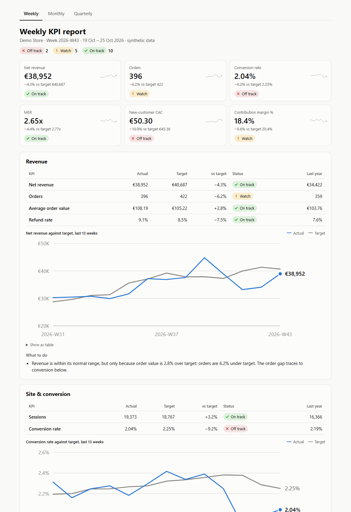

# AI-built KPI report kit

Turns raw Shopify, Meta Ads, Google Ads, TikTok Ads and GA4 exports into weekly, monthly and quarterly e-commerce KPI reports. Every metric is measured against a target calculated from the store's own history, never typed in, and every report section ends with actions that follow from the numbers.

Built with Claude Code on synthetic data: nothing here comes from a real store.



## What it produces

- **`output/kpi-report.xlsx`.** Report tabs with a period picker sit on top of KPI tabs. On the KPI tabs, every actual, target, miss and band is a formula you can click and trace back to the period data. It uses only long-established functions (`INDEX`, `MATCH`, `SUM`, `QUARTILE`), so it works in Excel, Google Sheets and LibreOffice.
- **`output/kpi-report.html`.** The same numbers as one shareable page with trend charts, for readers who won't open a spreadsheet.

## Run it

```bash
python -m venv .venv
.venv/Scripts/activate        # macOS/Linux: source .venv/bin/activate
pip install -r requirements.txt
python -m kpi_kit demo
```

`demo` writes three years of deliberately messy synthetic exports to `data/raw/` and builds both reports in about ten seconds. To build from exports you already have, run `python -m kpi_kit build --raw <folder>`.

## How targets and statuses work

**Target.** A target is the same period last year, scaled by how the brand is growing right now:

```
target = same period last year × (last 13 weeks ÷ the same 13 weeks a year earlier)
```

- Weekly targets average last year's week with its two neighbours. Monthly targets use a 3-month growth window, and quarterly targets use 2 quarters.
- Growth is capped between −33% and +50%.
- Ratio KPIs (conversion rate, MER, CAC, margins) use ratios of sums.

**Status.** Each KPI misses its target by a different amount in a normal period. The band is the interquartile range of the KPI's own misses over the previous 13 weeks (6 months, 4 quarters):

| Status | Miss |
|---|---|
| On track | within half the band |
| Watch | within the band |
| Off track | beyond the band |

In the demo week, revenue is 4.3% under target and On track, because this store's weekly revenue normally misses by about ±11%. Conversion rate is 9.2% under target and Off track, because conversion normally barely moves.

The bands also beat a flat ±5% rule over the last 52 weeks:

| KPI | Flat ±5% rule | Own band |
|---|---|---|
| Revenue | flags 17 weeks, mostly normal noise | marks 5 Off track |
| Conversion rate | catches 7 misses | catches 9, because small conversion drops matter |

**Actions.** Each section's actions come from rules over the numbers and their breakdowns: devices, ad channels, SKUs and cost components. For the demo week they find that:

- the conversion drop is mobile-only and started in week 41;
- Meta prospecting CPMs rose 25%, so about €800 a week should move to Performance Max;
- returning-customer share is up only because new-customer volume fell.

The same numbers always produce the same advice, and every line traces back to a rule.

[docs/method.md](docs/method.md) covers each of these choices, why it was made and its known limits.

## The mess it cleans up

The cleaning step logs every fix on the workbook's Data checks tab.

**Shopify orders**
- One row per line item, with order fields on the first row only.
- Two exports overlap by a month. The older one is missing refunds made after it was pulled, so the newer version wins.
- Staff test orders are mixed in with real ones.
- Cancelled and unpaid orders are excluded.
- Timestamps carry daylight-saving offsets.

**Refunds**
- A separate export, booked on the refund date.
- Reconciled against each order's refunded amount.

**Ad platforms**
- Google Ads puts report-title lines above the header and writes numbers as text, such as `1,234.56` and `--`.
- Meta prepends a summary row.
- TikTok writes day-first dates and appends a totals row.

**GA4**
- Comment lines sit above the header.
- Dates are written as `YYYYMMDD`.
- Purchases are lost to consent banners, so conversion rate uses Shopify orders.

**Product costs**
- The sheet is semicolon-separated with comma decimals.
- One SKU is missing; it is costed at 40% of net price and flagged.

## KPIs

| Section | KPIs |
|---|---|
| Revenue | Net revenue, orders, average order value, refund rate |
| Site & conversion | Sessions, conversion rate |
| Acquisition | Ad spend (paced, not judged), MER, new customers, new-customer CAC, platform ROAS for Meta, Google and TikTok |
| Retention | Returning-customer share, 90-day repeat rate |
| Profit | Gross margin %, contribution margin, contribution margin % |

Definitions are on the workbook's KPI definitions tab and in `kpi_kit/kpis.py`.

## Layout

```
kpi_kit/
  synth.py         synthetic messy exports, with a planted story in the last weeks
  clean.py         loaders and data checks
  facts.py         period tables (week, month, quarter) and breakdowns
  kpis.py          the KPI dictionary
  targets.py       targets, misses, bands and status (the Python twin of the workbook formulas)
  actions.py       the action rules
  workbook.py      the Excel workbook
  html_report.py   the HTML report
tests/             pipeline tests, plus a check that every workbook formula equals targets.py
```

## Tests

```bash
pytest
```

- One test re-derives a target and its band by hand, from the method as written above.
- Another loads the built workbook into an independent formula engine (the `formulas` package) and compares all 14,598 KPI-tab values, plus each report tab's statuses, with the Python results. It runs in about a minute.

## Assumptions

All of these are in `kpi_kit/config.py`:

| Item | Assumption |
|---|---|
| VAT | Prices include 25%. Revenue is reported ex VAT. |
| Payment fees | 1.9% + €0.25 per order |
| Fulfilment | €5.20 per order + €0.90 per extra unit |
| COGS | Net of restocked returns |
